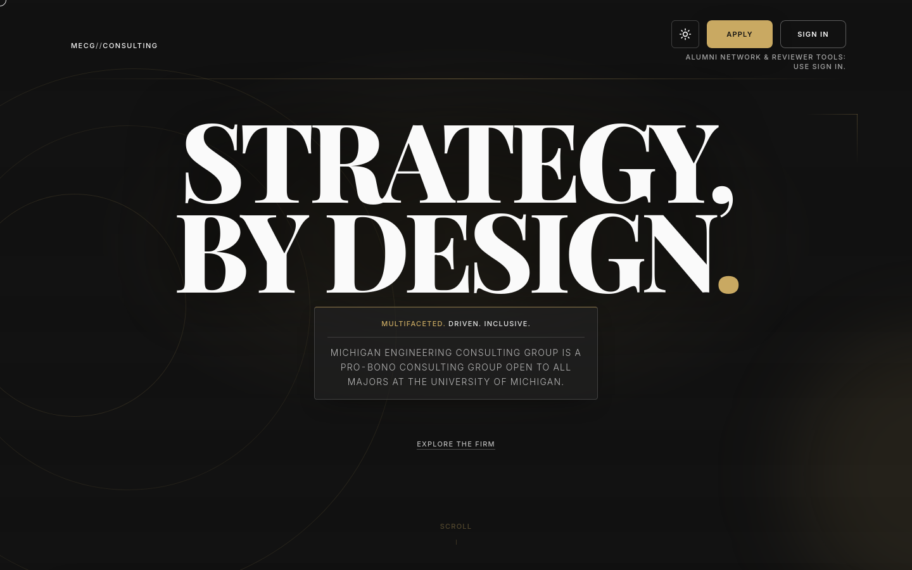

# MECG website: sign-up, application and review portal for Michigan Engineering Consulting Group



**Live:** [mecg-website-one.vercel.app](https://mecg-website-one.vercel.app)

A Vite, React and Supabase site for the Michigan Engineering Consulting Group (MECG), a student consulting group at the University of Michigan. It has a public landing page and a portal where applicants apply, reviewers screen applications, alumni join a network and admins manage roles. Rahil Bhavan is the only committer to this repository. This is the March 2026 build; the group's current recruiting site is a separate repository (`mecgrecruitment/mecg-website`).

## What it does

- **Public site.** Landing page with firm, impact, history, join and contact sections (`src/components/`), plus sign-up, sign-in and password reset.
- **Applicant flow.** `/apply` with draft saving and a required headshot upload to a private Supabase Storage bucket.
- **Reviewer flow.** `/review` shows one application at a time as a card with Pass, Maybe and Yes actions.
- **Alumni and admin.** `/network` for alumni; `/admin/*` for role, application, review, directory and network-event administration. Access follows rows in `public.user_roles`.

## How it works

The client is a single-page app (`src/`, React Router 7, Tailwind 4). `src/lib/supabase.ts` talks to Supabase for auth, data and storage. Row-level security and migrations are in `supabase/` and described in [`docs/supabase/rls-and-routes.md`](docs/supabase/rls-and-routes.md). The member roster page is generated from a spreadsheet and photos that are not in the repository (`bun run roster:import`). An optional three.js hero layer needs WebGL.

## Run it

Needs [Bun](https://bun.sh). The landing page rendered from the production build with placeholder Supabase values; sign-in and the portal need a real Supabase project.

```bash
bun install --frozen-lockfile
cp .env.example .env.local   # set VITE_SUPABASE_URL and VITE_SUPABASE_ANON_KEY (public anon key; never a service-role key)
bun run dev                  # http://localhost:3000
bun run lint && bun run test && bun run build && bun run check:bundle
```

Observed on 2026-10-24: lint (TypeScript and Biome), 7 unit tests and the build pass, and the bundle budget check passes. The Playwright end-to-end suite runs in CI; the credentialed tests skip unless the `E2E_*` variables below are set. I could not run it locally because the installed Playwright browsers did not match the project's version.

## Repository layout

- `src/`: the application (pages, components, auth, Supabase client).
- `supabase/`: CLI config and 5 SQL migrations.
- `tests/`: Vitest unit test and Playwright end-to-end specs.
- `scripts/`: roster import, Open Graph image and bundle-budget scripts.
- `components/`, `lib/`: shadcn-style UI primitives and helpers.
- `public/`: favicon, Open Graph image, member headshots (WebP) and client logos.
- `docs/`: brand system, UI plan and Supabase route notes.

## Documentation

- [`docs/brand/README.md`](docs/brand/README.md): brand tokens, colour, layout and accessibility rules.
- [`docs/supabase/rls-and-routes.md`](docs/supabase/rls-and-routes.md): which role can reach which route and table.
- [`docs/implementation-plan-ui-ux.md`](docs/implementation-plan-ui-ux.md): the UI and UX improvement plan.

## Scope and limits

- The group's current recruiting platform lives in another repository, so this one may not match it. This is not an official University of Michigan site.
- The public roster in `public/headshots/` and `src/data/roster-w26.ts` names club members and shows their photos. Confirm each member agreed to a public repository.
- The impact and club claims on the landing page are the group's own copy and are not checked here.
- Not verified: sign-in and portal flows against a live Supabase project, the Playwright suite on this machine, and WebGL rendering.
- No license file yet.


## Observability and analytics

Optional env vars (see [`.env.example`](.env.example)):

- **`VITE_SENTRY_DSN`** — client error reporting (Sentry). In dev, set **`VITE_SENTRY_DEV=true`** to enable.
- **`VITE_PLAUSIBLE_DOMAIN`** — loads Plausible; SPA page views and custom **`Funnel`** events on signup submit and apply submit.
- **`VITE_ANALYTICS_EVENTS_ENDPOINT`** — HTTPS URL receiving small JSON **`sendBeacon`** bodies for `pageview` / `funnel` (production only). Separate from **`VITE_WEB_VITALS_ENDPOINT`** (Core Web Vitals).

## SEO note (SPA)

`react-helmet-async` updates title, canonical, and Open Graph per route in the live app. Many link-preview crawlers do not execute JavaScript; if per-URL share cards for `/login` or `/signup` are critical, add **prerender** for those paths (e.g. a Vite prerender plugin) or **bot-specific HTML** at the edge.

## E2E credentials

`tests/e2e/critical-paths.spec.ts` runs **only when** role env vars are set (loaded from `.env.local` by Playwright if present):

- **`E2E_APPLICANT_EMAIL`** / **`E2E_APPLICANT_PASSWORD`**
- **`E2E_REVIEWER_EMAIL`** / **`E2E_REVIEWER_PASSWORD`**
- **`E2E_ALUMNI_EMAIL`** / **`E2E_ALUMNI_PASSWORD`**
- **`E2E_ADMIN_EMAIL`** / **`E2E_ADMIN_PASSWORD`**

Use a staging Supabase project and dedicated test users with the right `user_roles`. Review and apply tests **skip** when the queue is empty or the applicant has already submitted.

Optional: `bun run test:e2e:save-auth` (with applicant env vars set) writes `tests/.auth/applicant.json` for reuse in a custom Playwright `storageState` project.

Supabase schema docs: [`docs/supabase/rls-and-routes.md`](docs/supabase/rls-and-routes.md). Regenerate DB types after `db:start`: `bun run db:types`.

## shadcn-style UI

- Primitives live under [`components/ui/`](components/ui/) with `cn()` in [`lib/utils.ts`](lib/utils.ts). Imports use the `@/` alias (repo root), e.g. `@/components/ui/button`.
- Demo: `http://localhost:3000/balloons-demo` while the dev server runs (`balloons-js` + Button).
- To add more shadcn components: `bunx shadcn@latest init` (choose Vite + Tailwind + `@/*` → `./*`), then `bunx shadcn@latest add …` so paths stay aligned with `components.json`.

Part of [Rahil Bhavan's projects](https://github.com/RahilBhavan).
